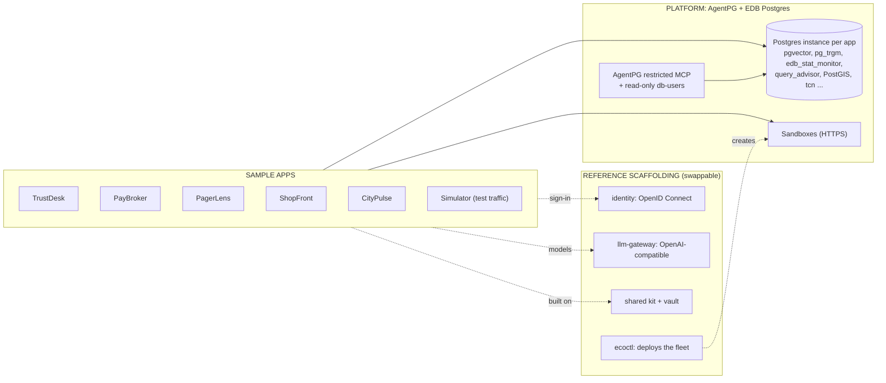
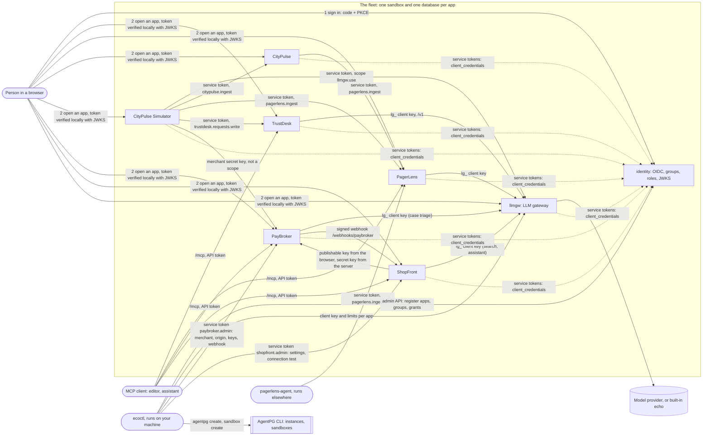

# ecoctl and the ecosystem: the complete guide

This is the one document to read for `ecoctl` and for the fleet it deploys. It was written against the code in `src/ecoctl/` and the tests in
`tests/` on 2026-10-27; where a statement could not be checked in code it is marked **(not verified)**. For a click-by-click first deployment
with screenshots of what to expect, [DEPLOY.md](DEPLOY.md) is still the companion; where the two differ, this guide follows the code
(section 17 lists the differences).

## Historical documents

These four were written as reports on a given day. They are kept for their reasoning and are **not maintained**; numbers, URLs and "open
problems" in them are out of date.

| Document | What it is | Status |
|---|---|---|
| [01-state-of-the-projects.md](01-state-of-the-projects.md) | State of every project on 2026-10-25, with an evening update | historical |
| [02-deployment-operations-integration.md](02-deployment-operations-integration.md) | Deployment, operations and AI use as of 2026-10-25 | historical (superseded by this guide) |
| [03-aidb-integration.md](03-aidb-integration.md) | A design for using AIDB, with a spike plan | historical design; section 15 here gives the current status |
| [04-showcase-readiness-plan.md](04-showcase-readiness-plan.md) | Work packages to make the projects showcase-ready | historical plan; some packages are done (the e2e suite), most are not |

[DEPLOY.md](DEPLOY.md) is a maintained how-to (it has a few stale numbers, listed in section 17). [../e2e/README.md](../e2e/README.md) and
[../e2e/FINDINGS.md](../e2e/FINDINGS.md) are current.

## Contents

1. [What the ecosystem is for](#1-what-the-ecosystem-is-for)
2. [The projects](#2-the-projects)
3. [How they interact](#3-how-they-interact)
4. [The dependency and ordering model](#4-the-dependency-and-ordering-model)
5. [Install](#5-install)
6. [The manifest reference](#6-the-manifest-reference)
7. [Commands](#7-commands)
8. [The state file](#8-the-state-file)
9. [Secrets and rotation](#9-secrets-and-rotation)
10. [The release loop](#10-the-release-loop)
11. [First sign-in and access](#11-first-sign-in-and-access)
12. [Recovery and troubleshooting](#12-recovery-and-troubleshooting)
13. [Tear-down](#13-tear-down)
14. [The end-to-end suite](#14-the-end-to-end-suite)
15. [AIDB integration status](#15-aidb-integration-status)
16. [How to add a new app](#16-how-to-add-a-new-app)
17. [Known gaps and documentation differences](#17-known-gaps-and-documentation-differences)
18. [EDB and AgentPG capabilities used](#18-edb-and-agentpg-capabilities-used)

---

## 1. What the ecosystem is for

A set of sample applications, all on Postgres with pgvector, built to show **EDB AIDB and AgentPG** (Postgres + pgvector + MCP + AI) working
together: sandboxes with a database each, public HTTPS, scale-to-zero, a shared identity provider and a shared LLM gateway. They are teaching samples. Nothing sells
anything, the payment processors are simulated, and the data is synthetic.

`ecoctl` is the tool in this repository. It reads one file, [`ecosystem.yaml`](../ecosystem.yaml), and does the repetitive part of putting the
fleet on AgentPG: one database instance and one sandbox per app (through the `agentpg` CLI), registration of every app with the identity
provider, the LLM gateway client for each app that uses a model, the groups and role grants, and the wiring between ShopFront and PayBroker.
It is idempotent: running the same command again converges and never rotates a secret unless asked.

## 1.1 What is the platform, what is scaffolding, what is a sample

Every box in this ecosystem is exactly one of three things. Read the diagrams and the videos with this key.

| Category | What it is | Items |
|---|---|---|
| **Platform** (AgentPG and EDB Postgres) | What a customer gets from the platform itself | The Postgres instance and its extensions (pgvector, pg_trgm, `edb_stat_monitor`, `edb_pg_tuner`, `query_advisor`, PostGIS, `unaccent`, `fuzzystrmatch`, `tcn` and about 35 more, see section 6.2; AIDB once access is granted), sandboxes with an exposed HTTPS port, `agentpg db-users`, `agentpg recommend`, AgentPG's MCP server |
| **Reference scaffolding** (useful, swappable) | Plumbing we built so the samples work end to end | identity (OpenID Connect provider), llm-gateway, the shared kit (including its vault), the labelled demo stand-in model, `ecoctl` |
| **Sample apps** | Customer-shaped stories that show what you can build | TrustDesk, PayBroker, PagerLens, ShopFront, CityPulse, the CityPulse Simulator (test traffic) |



**What is swappable, exactly** (checked against the code, not assumed):

| Scaffolding | How to swap it | The real condition |
|---|---|---|
| identity | Point `<PREFIX>_OIDC_ISSUER`, `_CLIENT_ID`, `_CLIENT_SECRET` at another provider | It must speak standard OpenID Connect (discovery, JWKS, PKCE) **and** be configured to emit a `roles` claim with app-namespaced role names (for example `trustdesk:admin`) and, for service clients, a `scope` claim. Only our own identity has been tested. |
| llm-gateway | Point `LLM_BASE_URL` and `LLM_API_KEY` at any OpenAI-compatible endpoint | Embedding size must match `EMBEDDING_DIM`; budgets and per-app limits are a gateway feature you give up with a plain provider endpoint. |
| vault | One module of the kit (`apgkit.vault`): replace it, or replace where its key comes from | Not a setting. The key comes from `<PREFIX>_ENCRYPTION_KEY` (platform-managed) or the admin password. |
| ecoctl | Not needed to run any app; it only deploys the fleet | Any other way of creating the instances and sandboxes works. |

## 2. The projects

All sibling directories live next to `ecosystem/` under `/Users/charly.batista/proj/edb/dev-cloud`. Each has its own README; this is the
short version. The first column is the manifest key.

**`identity`** (repo `identity`, image `identity`). The ecosystem's own OpenID Connect provider. Authorization code with mandatory PKCE,
rotating refresh tokens, `client_credentials` for services, discovery, JWKS, introspection and logout. People, groups and per-app roles live
here; an app defines its roles, people hold them directly or through groups, and an access token carries only the roles of the app it is
for. Optional Google and GitHub login (invite-only by default). It is deployed first, and its public URL is its issuer, which is why
recreating it recreates everything. It is not an `apps:` entry; it has its own `identity:` section in the manifest.

**`agentpg-kit`** (library, import name `apgkit`; no sandbox). The shared building blocks every app is built from: configuration, Postgres
access that retries while a scaled-to-zero database wakes, a migration runner, the vault that encrypts stored secrets, password hashing, the
security middleware, metrics, an SSRF-guarded OpenAI-compatible client, and the OIDC pieces (`AppAuth`, `TokenVerifier`, `RelyingParty`,
`TokenSource`). That is why all apps read the same `<PREFIX>_OIDC_*` variables. `ecoctl` does not deploy it; it is installed into each app image.

**`llmgw`** (repo `llm-gateway`, image `llm-gateway`). One OpenAI-compatible endpoint (`/v1/chat/completions`, `/v1/embeddings`) in front
of model providers. Provider keys live only here. Each app gets its own revocable client key (`lg_...`) with a requests-per-minute limit, a
monthly token budget and a list of allowed model aliases (`chat-default`, `embed-default`). It ships a built-in `echo` provider, so every app
works before a real provider key exists. A service can instead authenticate with an identity token that has scope `llmgw.use`. Apps need no
code change: the gateway is just an "OpenAI-compatible account".

**`trustdesk`** (repo `trustdesk`). A compliance workspace. Company policies are ingested, chunked and embedded; applications send employee
requests (leave, trips, expenses) through a client API; each request is pre-validated by a model against the policies and gets a
recommendation, reasons and quoted passages (quotes are checked word for word). A person decides, and going against the advice needs a
written justification. Has reports and an MCP server. Uses the gateway for chat and embeddings (`llm: true`).

**`pagerlens`** (repo `PagerLens`). An incident-investigation agent. It ingests logs, metrics, deploys and alerts, gathers read-only
evidence when an alert fires, ranks causes with the evidence that supports or refutes each, suggests runbook steps and remembers confirmed
causes. Methods: Rules, AI, or both reconciled. A Lab breaks a fictional shop on demand. Has an MCP server. Uses the gateway (`llm: true`).
Accepts telemetry from callers that hold the scope `pagerlens.ingest`.

**`citypulse`** (repo `CityPulse`). A smart-city sensor platform on plain Postgres: an ingest gateway with back-pressure, a status engine that
turns readings into a city-wide verdict, a dashboard and a burst button that stresses the system on purpose. In this fleet it runs with
`CITYPULSE_ROLE=api` (no built-in simulator) and reports its health to PagerLens with a service token.

**`cpsim`** (repo `CityPulseSimulator`, image `citypulsesimulator`). The field side and the load generator. It builds cities of simulated
sensors that send readings to CityPulse (through simulated industrial protocols and an edge gateway), and "companies" and "workloads" that
send requests to TrustDesk, payments to PayBroker and calls to the gateway. It holds the addresses of the whole fleet so its targets can
say `${CITYPULSE_URL}` and follow a recreated app.

**`paybroker`** (repo `paybroker`). A payment broker sample: one payment API in front of simulated processors, smart routing, a three-tier fraud engine
(rules, an in-process gradient-boosted model, asynchronous model triage through the gateway), a card vault that accepts test cards only,
signed webhooks, a dashboard and an MCP server. Uses the gateway (`llm: true`). Merchants call it with merchant keys, not identity scopes;
only `paybroker.admin` is an identity scope, held by `ecoctl`.

**`shopfront`** (repo `shopfront`). A small web shop that takes test-card payments through PayBroker: catalog, hybrid search (full text,
typo tolerance and semantic similarity), cart, browser-side card tokenization (card numbers never reach the shop's server), 3-D Secure,
signed and idempotent webhooks, a back office and an order-support assistant that uses the gateway (`llm: true`). `ecoctl connect` wires it
to PayBroker.

**`pagerlens-agent`** (part of the PagerLens repo, `deploy: false`). A collector that runs next to what it watches, outside AgentPG. `ecoctl`
only registers it with the identity provider (a service client allowed `pagerlens.ingest`) and prints its settings with `ecoctl env`.

**`ecosystem`** (this repository). `ecoctl`, the manifest, the docs and the Playwright suite in `e2e/`. At runtime `ecoctl` is also an identity
client named `ecoctl`, used only to connect apps (section 7.8).

## 3. How they interact



How to read it:

- **Sign-in goes through `identity`.** A person signs in once; each app redirects to the provider (authorization code with PKCE), then verifies
  the signed tokens locally against the provider's JWKS and maps the person's roles in that app to what they may do. Role changes reach an app
  at the person's next sign-in.
- **Service-to-service calls use short-lived tokens, not copied secrets.** An app with `calls:` has a second identity client,
  `<key>-service`, allowed exactly the scopes it lists. It gets a token with `client_credentials` for **one audience app at a time**; the callee checks the
  scope. This is how CityPulse reports to PagerLens and how the Simulator feeds CityPulse, TrustDesk and PagerLens.
- **Model calls go through the gateway.** Five apps (TrustDesk, PagerLens, PayBroker, ShopFront, the Simulator) get `LLM_BASE_URL`, `LLM_API_KEY` and the
  model aliases in their environment. Repointing `chat-default` in the gateway moves every app to another model with no other change.
- **Data flows.** CityPulse to PagerLens: the Simulator sends readings to CityPulse; CityPulse's status engine and alerts are pushed to
  PagerLens (and PagerLens can scrape `/metrics`); the incident appears with evidence. ShopFront to PayBroker: the browser tokenizes the card
  at PayBroker, the shop's server authorizes and captures with the merchant secret key, and PayBroker sends signed webhooks back. TrustDesk to
  the gateway: policy embeddings and the AI pre-validation of each request.
- **MCP.** TrustDesk, PagerLens, PayBroker and ShopFront each serve an MCP endpoint at `/mcp` (streamable HTTP) with read-oriented tools for
  an assistant; they authenticate with the app's own API tokens. The fleet's MCP surface is per app. An in-database MCP endpoint from AIDB is not
  part of the fleet yet (section 15).
- **`ecoctl` is a client of the fleet, not part of it at runtime.** It talks to the `agentpg` CLI, to the identity admin API (with a static
  admin key it generated), to the gateway's admin API (with a static operator key it generated), and, for `connect`, to PayBroker and
  ShopFront with tokens of its own service client.

## 4. The dependency and ordering model

Everything is derived from the manifest; there is no separate ordering list.

| Rule | Where it comes from | Effect |
|---|---|---|
| The identity provider is first | `plan.build` | Its first request fixes the issuer, so `ecoctl` makes that request over the public URL (`pin_issuer`). Every app's `<PREFIX>_OIDC_ISSUER` is that URL |
| **Callees before callers** | `calls`, `uses` | A caller's environment names the callee's URL, so the callee must exist first. `manifest.order()` is a depth-first walk; a cycle is a validation error |
| The gateway before its consumers | `llm: true` | `needs(app)` contains the gateway app, so it is created first and the app's gateway client is made before its sandbox |
| Groups after the apps | `access.groups` | Grants need the apps' clients to exist |
| `connect` last | `apps.<app>.connect` | The `ecoctl` service client is registered, then each connection is reconciled once both ends are up |

`needs(app)` is the union of `calls`, `uses` (without `identity`) and the gateway for an LLM app. It drives four things: creation order,
`--only` (adds everything the selection needs, transitively), the **recreate cascade** (every app that needs a recreated app is recreated too,
transitively), and cycle detection.

**Why a recreate cascades.** A sandbox's URL contains its id, so a deleted and recreated sandbox gets a new URL. A sandbox's environment is fixed when it is
created (`ecoctl` does not change it in place), and the environment of a caller names the callee's URL. So recreating `paybroker` recreates
`cpsim` and `shopfront` (they use it); recreating `shopfront` recreates `cpsim` (it calls it); recreating `llmgw` recreates the five apps that use it (`cpsim` among them, which also calls it); recreating
`identity` recreates all of them.

For the shipped manifest the creation order is `identity`, `llmgw`, `pagerlens`, `citypulse`, `paybroker`, `shopfront`, `trustdesk`, `cpsim`, `pagerlens-agent`
(registered only): a depth-first walk over the keys in alphabetical order, callees first (worked out from `manifest.order()`, not copied from a run).

## 5. Install

### 5.1 Prerequisites

| Need | Detail |
|---|---|
| Python 3.11+ and [uv](https://docs.astral.sh/uv/) | `pyproject.toml` says `requires-python >= 3.11`; runtime dependencies are `pyyaml` and `httpx` only |
| The `agentpg` CLI, logged in | `agentpg login` opens a browser flow. `ecoctl` runs `agentpg create`, `keys`, `extensions create`, `instances list`, `sandbox create|list|status|delete`, and for `insights` and `mcp` also `recommend all`, `db-users list|create`, `connect` and `mcp serve`. A stale login shows as "Invalid or expired token": log in again |
| An AgentPG account with capacity | The shipped manifest creates **eight** instances and eight sandboxes (identity, llmgw, trustdesk, pagerlens, citypulse, cpsim, paybroker, shopfront). If your plan allows fewer, deploy a slice with `--only` |
| **Public images**, built by CI | Each repository's GitHub Actions workflow "Build and publish image" pushes `ghcr.io/elchinoo/<image>:latest` on every push to `main`. The packages are **private by default**; AgentPG pulls anonymously, so each must be made public once (a click per package, no API). Section 5.2 |
| A machine you trust | Secrets reach sandboxes as `--env` values on the `agentpg` command line, so they pass through that machine's process list for a moment. `.ecosystem/` on that machine holds every secret |
| Model access (optional) | The gateway's `echo` provider works with nothing. For real answers add one chat provider and one embedding provider in the gateway console, then repoint the two aliases (section 7.7). The embedding model must return `llm.embed_dimensions` numbers (the manifest says 1536) |
| Node 22, Chrome, Postgres 17 with pgvector (only for the e2e suite) | Section 14 |

### 5.2 Make the images public

1. Check the builds: `gh run list -R elchinoo/<repo> -w "Build and publish image" -L 1` must say `completed success` for each of `identity`, `TrustDesk`, `PagerLens`,
   `CityPulse`, `CityPulseSimulator`, `PayBroker`, `llm-gateway` and `ShopFront`.
2. For each package at <https://github.com/elchinoo?tab=packages>: Package settings, Danger Zone, Change visibility, Public.
3. Verify anonymously (200 means public and present; 401 or 404 means still private or not built). Image names are the manifest's `image` values: `identity`, `trustdesk`,
   `pagerlens`, `citypulse`, `citypulsesimulator`, `paybroker`, `shopfront`, `llm-gateway`.

```bash
for i in identity trustdesk pagerlens citypulse citypulsesimulator paybroker shopfront llm-gateway; do
  tok=$(curl -s "https://ghcr.io/token?scope=repository:elchinoo/$i:pull" | python3 -c 'import sys,json; print(json.load(sys.stdin)["token"])')
  code=$(curl -s -o /dev/null -w '%{http_code}' -H "Authorization: Bearer $tok" -H 'Accept: application/vnd.oci.image.index.v1+json' "https://ghcr.io/v2/elchinoo/$i/manifests/latest")
  echo "$i: $code"
done
```

A sandbox that fails with `provisioning failed (HTTP 400)` almost always means the image is private or missing. (The loop above is the one in
DEPLOY.md with `shopfront` added; the ShopFront package name is **not verified**.)

### 5.3 Install ecoctl

```bash
cd /Users/charly.batista/proj/edb/dev-cloud/ecosystem
uv venv && uv pip install -e ".[dev]"
.venv/bin/ecoctl validate
```

`validate` prints `ok: fleet 'eco', identity + 8 apps (...)` where the list is the creation order. (The count is of `apps:` entries, which includes
`pagerlens-agent`; the sandbox count is one lower for apps plus one for identity.) Run `ecoctl` from this directory, or pass `-f` and `--state`.

### 5.4 Develop and test ecoctl

```bash
make lint && make test        # ruff check src tests; pytest -q
```

The unit tests use a fake `agentpg` binary and mock HTTP transports; `tests/conftest.py` makes any real network call fail the test. The
identity integration test (`tests/test_identity_integration.py`) needs `TEST_DATABASE_URL` and the sibling `identity` and `agentpg-kit` installed.
CI (`.github/workflows/test.yml`) runs ruff and pytest on push to `main` and on pull requests.

## 6. The manifest reference

`ecosystem.yaml` is validated strictly by `src/ecoctl/manifest.py`: **an unknown key anywhere is an error**, and a message names the path
(`apps.shopfront.connect.paybroker: ...`). Top-level keys: `version`, `fleet`, `agentpg`, `identity`, `apps`, `access`, `llm`.

### 6.1 Top level

| Key | Rule |
|---|---|
| `version` | Must be `1` |
| `fleet` | Required. Lowercase letters, digits and dashes, at most 20. Prefix of every name: sandbox `<fleet>-<app>`, instance `<fleet>-<app>-db` |
| `agentpg.registry` | Image registry path, default `ghcr.io/elchinoo`. An image is `<registry>/<app.image>:<tag>` |
| `agentpg.tag` | Image tag, default `latest` |
| `agentpg.size` | Database size passed to `agentpg create --size`, default `small` (free text; AgentPG decides what is valid) |
| `agentpg.auto_pause` | Boolean, default `true`. The shipped file sets `false`. Paused sandboxes answer an empty 503 and do not wake on a request |
| `agentpg.plan` | `small`, `medium` or `large`: the compute plan of every sandbox. Unset: the platform default |
| `identity` | An app-like section for the provider (below). `identity.calls` is refused |
| `apps` | A mapping of at least one app. The names `identity` and `ecoctl` are reserved |
| `access.groups` | Groups and their grants (6.4) |
| `llm` | The gateway wiring (6.3) |

### 6.2 An app (`apps.<key>`, and `identity`)

The key is 2 to 40 characters, lowercase letters, digits and dashes, and it is the identity client id, the sandbox name suffix and the scope
prefix. Every key below is optional unless said.

| Key | Type and default | Meaning |
|---|---|---|
| `name` | text, default the key | Display name in the identity console and in plans |
| `description` | text, at most 300 chars | Shown in the identity console |
| `image` | text, default the key | Image name under the registry. Note `cpsim` uses `citypulsesimulator`, `llmgw` uses `llm-gateway` |
| `port` | 1-65535, default `8000` | The port the container listens on |
| `health` | path, default `/healthz` | What `ecoctl status` calls. It also calls `/readyz` |
| `extensions` | list | Postgres extensions created on the app's instance, by `apply`, also on an instance that already exists (section 7.3). Allowed, exactly what installs and works for an instance's role (two probe rounds on 2026-10-28, the first incomplete; the full table is in [06-edb-and-agentpg-capabilities.md](06-edb-and-agentpg-capabilities.md) section 2): `vector`, `pg_trgm`, `unaccent`, `citext`, `fuzzystrmatch`, `tcn`, `btree_gin`, `btree_gist`, `cube`, `tsm_system_rows`, `tsm_system_time`, `postgis`, `postgis_raster`, `postgis_sfcgal`, `postgis_tiger_geocoder`, `postgis_topology`, `edb_stat_monitor`, `query_advisor`, `edb_pg_tuner`, `sql_profiler` (only its version function is visible), `anon` (`anon.partial()` and `anon.hash()` work; `anon.fake_*()` do not; no dynamic masking), `pgcrypto`, `hstore`, `ltree`, `tablefunc`, `intarray`, `isn`, `lo`, `seg`, `dict_int`, `pgfs`, `aidb` (installs, the role lacks its grants), and the EDB-specific `refdata`, `bluefin`, `autocluster` (install, usefulness untested). Rejected with a reason: 26 extensions that need superuser on this platform (`data_redaction`, `pg_prewarm`, `pgstattuple`, `pgrowlocks`, `password_profile`, `sslinfo`, `earthdistance`, `pg_surgery`, `amcheck`, `autoinc`, `bloom`, `dblink`, `dict_xsyn`, `file_fdw`, `insert_username`, `intagg`, `moddatetime`, `pageinspect`, `pg_buffercache`, `pg_freespacemap`, `pg_logicalinspect`, `pg_visibility`, `pg_walinspect`, `postgres_fdw`, `refint`, `xml2`); `address_standardizer*` and `system_stats` (install but are unusable: permission denied); `pgaa` (installs, needs bdr or an object store); `uuid-ossp` (the CLI rejects the hyphen). See section 18 |
| `env` | mapping | Non-secret environment values. A name containing SECRET, PASSWORD, PASSWD, TOKEN, KEY, DSN or CREDENTIAL is refused, and so is a value with `user:password@` in a URL. Use `generate` for secrets |
| `generate` | list of env names | Each gets a random URL-safe secret (32 bytes), created once and kept in the state file, passed to the sandbox as a secret `--env` |
| `env_prefix` | upper-case identifier, default the key upper-cased with `-` as `_` | Prefix of the app's own variables: `<PREFIX>_OIDC_ISSUER`, `_OIDC_CLIENT_ID`, `_OIDC_CLIENT_SECRET`, `_SERVICE_CLIENT_ID`, `_SERVICE_CLIENT_SECRET`, `<PREFIX>_URL` |
| `roles` | list of `{name, description}` | The roles the identity provider offers for this app. Names: lowercase letters, digits, `.`, `_`, `-` |
| `default_roles` | list | Roles every user gets in this app. Must be roles the app defines |
| `exposes` | list of scopes | Scopes other services may request **from** this app. Each must be `<key>.<thing>` |
| `calls` | mapping callee -> list of scopes | Scopes this app's service client may request **from** the callee. Each scope must start with `<callee>.` and be listed in the callee's `exposes`, so a typo fails at `validate`. A non-empty `calls` creates the service client `<key>-service`, allowed those scopes and the callee audiences |
| `uses` | list of app keys, or `identity` | Apps whose URL is injected **without a scope** (they are reached by other means: a merchant key, a browser). No service client. Not allowed to name itself, to repeat an app, or to also appear in `calls` |
| `url_env` | mapping callee -> env name | Which variable carries a callee's URL. Default `<CALLEE's env_prefix>_URL`. Only callees in `calls` or `uses` may be mapped |
| `web` | boolean, default `true` (`false` for `identity`) | Registers a browser sign-in (web) client named `<key>`. `false`: service only |
| `deploy` | boolean, default `true` | `false`: registered with the provider only; no instance, no sandbox (a job or CLI that runs elsewhere) |
| `auto_pause` | boolean | Overrides `agentpg.auto_pause` for this app |
| `plan` | `small`, `medium`, `large` | Overrides `agentpg.plan` for this app |
| `llm` | `true`, `false` or a mapping | Wires the app to the gateway (6.3). Needs `deploy: true` |
| `connect` | mapping peer -> `{merchant}` | After both are up, `ecoctl` connects the app to the peer. Only `paybroker` is a valid peer today (6.5) |

What `ecoctl` puts in an app's environment (`plan.app_env`), layered in this order (a later layer wins): the manifest `env`; each `generate` name; for the
identity provider `IDENTITY_API_KEY`; for any other app `<PREFIX>_OIDC_ISSUER` (the identity URL), and when `web`, `<PREFIX>_OIDC_CLIENT_ID` and
`_OIDC_CLIENT_SECRET`; when it has `calls`, `<PREFIX>_SERVICE_CLIENT_ID` and `_SERVICE_CLIENT_SECRET`; the URL of every `calls` and `uses` app
(`identity` included); and, for an LLM app, the five `LLM_*` and `EMBEDDING_*` names. Secrets are marked as secret in the `agentpg` command and
printed as `***` in plans and by `ecoctl env`.

### 6.3 `llm`: the gateway wiring

Global block (every key optional; the defaults are what the code uses):

| Key | Default in code | Shipped manifest | Meaning |
|---|---|---|---|
| `gateway` | `llmgw` | `llmgw` | The app that runs the gateway. Must exist, be deployed, and not itself be an LLM consumer |
| `chat_alias` | `chat-default` | same | Model alias for chat. Must differ from `embed_alias` |
| `embed_alias` | `embed-default` | same | Model alias for embeddings |
| `embed_dimensions` | `768` | `1536` | `EMBEDDING_DIM` of the apps and the gateway's default embedding size. Must equal the real embedding model's size. The vector tables of TrustDesk and PagerLens fix it when first migrated: change it only for a new fleet |
| `rpm` | `60` | `60` | Requests per minute of each app's gateway client (1-100000) |
| `budget` | `5000000` | `5000000` | Tokens per month per client; `null` for none |
| `budget_mode` | `hard` | `hard` | `hard` refuses over budget, `soft` allows and flags |

An app's `llm:` may be `true` (the global values) or a mapping with any of `rpm`, `budget` (a number or `null`), `budget_mode` and `aliases` (extra
aliases besides the two defaults; letters, digits, `.`, `_`, `:`, `-`, at most 60 characters, no repeats). **A mapping beats the global value**,
and `budget: null` in a mapping means "no budget for this app".

An app with `llm` must not set `LLM_BASE_URL`, `LLM_API_KEY`, `LLM_CHAT_MODEL`, `EMBEDDING_MODEL` or `EMBEDDING_DIM` in `env` or `generate`:
`ecoctl` owns them. The gateway app gets, automatically when any app uses it: the operator key `<PREFIX>_API_KEY` (`LLMGW_API_KEY`, generated)
and `<PREFIX>_DEFAULT_CHAT_ALIAS`, `_DEFAULT_EMBED_ALIAS` and `_DEFAULT_EMBED_DIM`.

Where a limit lives, least to most specific: the global `llm:` block, an app's `llm:` mapping, the gateway console (live), and
`ecoctl llm sync --apply`, which copies the first two onto the gateway on request. The manifest is read when `apply` **creates** a client and when you run
`sync --apply`; `apply` never overwrites an existing client's limits.

### 6.4 `access.groups`

```yaml
access:
  groups:
    risk-team:
      description: People who handle payment fraud
      grants: {paybroker: risk_manager, pagerlens: viewer}
```

A group name is lowercase letters, digits and dashes (at most 63). `grants` maps an app key to a role, or `"*"` to a role. For a named app the
role must be one the app defines (checked at `validate` for web apps). `"*"` grants the role in **every selected web app that defines it**
(so `{"*": admin}` skips an app without an `admin` role). Groups are only created when at least one grant target is part of the run
(`--only` can skip them). The shipped groups: `ecosystem-admins` (`*: admin`), `risk-team` and `support`.

### 6.5 `connect`

```yaml
  shopfront:
    uses: [paybroker]
    exposes: [shopfront.api, shopfront.read, shopfront.metrics, shopfront.admin]
    connect:
      paybroker: {merchant: "ShopFront"}
  paybroker:
    exposes: [paybroker.read, paybroker.metrics, paybroker.admin]
```

Validated: the peer is `paybroker`; it is not the app itself; both are in the manifest and deployed; the app lists the peer under `uses` or
`calls`; both `<app>.admin` scopes appear under `exposes`; the only key under the peer is `merchant`, 1 to 60 characters with no control
characters (the merchant's exact name in PayBroker). Section 7.8 says what it does.

### 6.6 What the shipped manifest declares

| App | `llm` | `calls` (scopes) | `uses` | `exposes` | Other |
|---|---|---|---|---|---|
| `trustdesk` | yes | | | `trustdesk.requests.write`, `.kb.read`, `.metrics` | `extensions: [vector, pg_trgm, query_advisor, edb_stat_monitor, edb_pg_tuner, unaccent, tcn]`, `AUTO_SEED=true`, roles admin, approver, viewer |
| `pagerlens` | yes | | | `pagerlens.ingest`, `.read`, `.metrics` | `extensions: [vector, pg_trgm, query_advisor, edb_stat_monitor, edb_pg_tuner, tcn]`, roles admin, responder, viewer |
| `citypulse` | | `pagerlens`: `pagerlens.ingest` | | `citypulse.ingest`, `.read`, `.metrics` | `extensions: [query_advisor, edb_stat_monitor, edb_pg_tuner, postgis]`, `CITYPULSE_ROLE=api` |
| `cpsim` | yes | `citypulse`: `.ingest`; `trustdesk`: `.requests.write`; `pagerlens`: `.ingest`; `llmgw`: `llmgw.use`; `shopfront`: `.api` | `paybroker`, `identity` | `cpsim.read`, `.metrics` | `extensions: [query_advisor, edb_stat_monitor, edb_pg_tuner]`, `env_prefix: CPSIM`, image `citypulsesimulator` |
| `paybroker` | yes | | | `paybroker.read`, `.metrics`, `.admin` | `extensions: [vector, query_advisor, edb_stat_monitor, edb_pg_tuner, fuzzystrmatch]`; five roles |
| `shopfront` | yes | | `paybroker` | `shopfront.api`, `.read`, `.metrics`, `.admin` | `extensions: [vector, pg_trgm, query_advisor, edb_stat_monitor, edb_pg_tuner, unaccent, fuzzystrmatch]`, `connect.paybroker.merchant: ShopFront`, `SHOPFRONT_TRUSTED_HOPS=1`, `url_env.paybroker=SHOPFRONT_PAYBROKER_URL` |
| `llmgw` | (is the gateway) | | | `llmgw.use`, `.read`, `.metrics` | `extensions: [query_advisor, edb_stat_monitor, edb_pg_tuner]`, `env_prefix: LLMGW`, image `llm-gateway` |
| `pagerlens-agent` | | `pagerlens`: `pagerlens.ingest` | | | `web: false`, `deploy: false`, `url_env.pagerlens=PAGERLENS_URL` |

## 7. Commands

Global options come **before** the subcommand: `ecoctl [-f FILE] [--state DIR] <command> ...`. `-f/--file` defaults to `ecosystem.yaml`;
`--state` defaults to `.ecosystem`. Exit codes: 0 success, 1 a refused or cancelled action, a bad argument, a manifest error or a failed status check, and 2 a failure while
changing something (progress is saved). Examples use `.venv/bin/ecoctl`.

### 7.1 `validate`

Checks the manifest and prints the creation order. Reads no state and touches nothing.

```
$ .venv/bin/ecoctl validate
ok: fleet 'eco', identity + 8 apps (llmgw, pagerlens, citypulse, paybroker, shopfront, trustdesk, cpsim, pagerlens-agent)
```

The list is the creation order for the shipped manifest, worked out by hand from the dependency walk in `manifest.order()` (not copied from a run).

### 7.2 `plan [--only a,b]`

Prints every `agentpg` command and identity or gateway call the run would make, numbered, with secrets masked. **Changes nothing and calls no service.**
`--only` takes comma-separated app keys, adds what they need (section 4), and always includes the identity provider; an unknown name fails immediately.

```bash
.venv/bin/ecoctl plan
.venv/bin/ecoctl plan --only trustdesk      # identity, llmgw, trustdesk
```

For an app whose instance already exists (it is in the state file) the extension lines list only the **missing** extensions, preceded by a note that apply waits for the instance to be running first; when none are missing it says they are already created.

The plan has these steps in order: the identity database and sandbox; identity ready and issuer pinned; then per app in order its identity
registration, its gateway client and key (LLM apps), its database and sandbox (the full `agentpg create`, `extensions create` and `sandbox create`
commands), and the redirect-URI step; then groups; then, when any `connect` exists, the `ecoctl` service client and each connection.

### 7.3 `apply [--execute] [--yes] [--only a,b] [--rotate]`

Prints the plan. Without `--execute` it is a **dry run** and says so. With `--execute` it asks `Continue? [y/N]` (skip with `--yes`) and runs
every step, printing `[n/N] title ...` and a one-line outcome.

```bash
.venv/bin/ecoctl apply                      # dry run, same as plan
.venv/bin/ecoctl apply --execute            # asks first
.venv/bin/ecoctl apply --execute --yes --only trustdesk
.venv/bin/ecoctl apply --execute --rotate   # section 9
```

What each step does (idempotent; every step checks what exists):

1. **Database and sandbox** (`_deploy`): find the instance by name (`<fleet>-<app>-db`) or create it, keeping the database key that `agentpg create --json` returns
   (shown only once; it is also the database password); wait until the instance is `running`; create each extension **that the state file does not list as created yet** (so adding an extension to the manifest and running `apply` again adds just that one to the existing instance; each success is saved before the next, a failure keeps what was done, and an "already exists" answer from the CLI counts as done); find the sandbox by name
   (`<fleet>-<app>`) or create it with the image, port, instance, `--auto-pause=false` when not pausing, `--plan` when set, and every `--env`; wait (up to 7 minutes) for a URL.
   A sandbox that disappeared behind your back is noticed and created again. If the sandbox exists and its environment now differs from what the
   manifest would give it, the outcome says "exists with a different environment: delete the sandbox and re-run" (use `recreate`).
2. **Register** (`_register`): create or patch the web client and the service client in the identity provider; the client secret is returned once and kept.
   An existing client of the wrong kind is an error.
3. **LLM gateway client** (`_llm_client`): wait for `/readyz` on the gateway, then create one client per app named after the app, with limits and aliases from the manifest; keep its `lg_` key.
   For an existing client: add any missing default alias; keep its limits; replace its key only when it is lost or you pass `--rotate`.
4. **Point sign-in at the real URL** (`_finish_urls`): set the launcher URL, the redirect URI `<url>/auth/callback` and the post-logout URI `<url>/` (a placeholder `https://pending.invalid/auth/callback` is used until the URL exists).
5. **Groups**: create each group and add the grants that are missing.
6. **Connect**: register `ecoctl`, then reconcile each connection (7.8).

When it finishes it prints the URL of every deployed app and reminds you to add yourself to the groups. If a step fails with an `agentpg`,
identity, gateway, connect or HTTP error it saves progress, prints `FAILED: ...` and exits 2; the same command resumes.

### 7.4 `recreate APPS [--yes]`

Deletes sandboxes (`agentpg sandbox delete <id> --force`; the **databases are kept**) and then runs `apply --execute` for everything that is deployed, so the sandboxes are
created again. Use it to pull a new image, to apply an environment change, or to give an app a rotated key. `APPS` is comma-separated app keys, or `identity`.

```bash
.venv/bin/ecoctl recreate paybroker            # also recreates shopfront and cpsim, which use it
.venv/bin/ecoctl recreate llmgw --yes          # also recreates the five llm apps (cpsim included)
.venv/bin/ecoctl recreate identity             # recreates every deployed app
```

It prints which apps were added by the cascade and which sandboxes it will delete, then asks (`--yes` skips). Only apps that actually have a sandbox in the state are
touched. Unknown names exit 1. The following apply never passes `--rotate`. The new URL of each recreated app is registered, and `connect` runs again, so the ShopFront origin and webhook follow a recreated shop or PayBroker.
Allow a couple of minutes per app (section 12).

### 7.5 `status`

Read-only. Prints one table and three sections, and exits 1 if anything is wrong.

1. **Apps**: for each deployed app, the HTTP status of its `health` path and of `/readyz` (`down` on a connection error), then the platform's live sandbox metrics: `cpu` and `mem` (latest point, percent) and `net in / out` (latest point, shown with the unit the platform reports, for example `1 kbps`). The metrics come from one `agentpg sandbox status <id> --json` call per app, run concurrently with a 15 s timeout. Anything unavailable (no metrics, empty series, paused sandbox, an older CLI that rejects `--json`, a failed or slow call) shows `-` and never fails `status`. `not deployed` when the state has no URL. The metrics columns are covered by fake-CLI tests; the `--json` shape was verified against the platform, but `status` itself was not run live with this feature.
2. **LLM gateway**: for each LLM app that has a sandbox, whether its gateway client exists, whether its limits match the manifest (`ok` or `DRIFT`), and one tiny chat
   completion made with the app's own key (this call is metered like any other, about one token). A drift is a warning that points to `llm sync`, not a failure.
3. **CONNECTIONS**: for each connected pair, merchant, origin, keys, webhook and the shop's own connection test. Read-only calls.
4. **database features** (printed before the LLM section): per deployed app, the extensions `ecoctl` created (read from the state file, **no call to the platform**) and any the manifest lists that are missing, with the hint to run `apply --execute`. It does not ask the database what is installed, so an extension someone added or removed by hand is not seen **(not verified live)**.
5. **identity registry**: for every client the deployment holds, whether it is registered, its kind, and `launcher URL differs` drift.

```
app             health    ready     cpu     mem     net in/out        url
identity        200       200       0.5%    12.6%   1 kbps / 1 kbps   https://...
```

The first column holds manifest keys, identity first. The sample row is illustrative of the layout in `cmd_status`, not captured output.

### 7.6 `env APP [--reveal]`

Prints the environment `APP` is created with, as `export NAME='value'` lines sorted by name. Secrets are `***` unless `--reveal` (which prints a warning to stderr). Works for
any app key including `identity` and apps with `deploy: false`. It is offline: it reads the manifest and the state file only.

```bash
.venv/bin/ecoctl env trustdesk
.venv/bin/ecoctl env pagerlens-agent --reveal > pagerlens-agent.env      # keep private
.venv/bin/ecoctl env identity --reveal | grep IDENTITY_API_KEY
```

### 7.7 `db APP [--reset]` and `llm test` / `llm sync`

**`db APP`** prints the database key of the app's instance (it is also the database password), kept from creation. `--reset` (or a missing key) rotates the
instance's `default` key (nothing in the fleet uses it; sandboxes get their own key from AgentPG) and saves the new one. Exit 1 if the app has no instance yet.

**`llm test APP`** makes one tiny chat call through the gateway with that app's own key and prints `ok` or `FAILED (detail)`; exit 0 or 1. The app must have `llm` in the manifest.

**`llm sync [APP ...] [--all] [--apply] [--prune-aliases]`** compares each consumer's gateway client with the manifest.

| Invocation | Effect | Exit |
|---|---|---|
| `llm sync` | table of differences (app, field, gateway, manifest, action) for every consumer; changes nothing | 0 in sync, 1 drift (usable in CI), 2 gateway error |
| `llm sync trustdesk` | compare only that app | same |
| `llm sync trustdesk paybroker --apply` | PATCH only the differing fields (`rpm_limit`, `monthly_token_budget`, `budget_mode`, `allowed_aliases`) of the named apps | 0, or 2 if a PATCH failed |
| `llm sync --all --apply` | the same for every consumer | |
| `llm sync --all --apply --prune-aliases` | also remove aliases the manifest does not list (default: kept and reported `extra, kept`) | |

`--apply` needs app names or `--all` (not both). Missing aliases are always added. A client that does not exist is reported `missing, run apply`; keys are never touched.

To use a real model: in the gateway console add a provider (name, base URL, key; test it), then open the model `chat-default` and point it at the
provider and model; do the same for `embed-default` with an embedding model that returns `embed_dimensions` numbers. No app, client or key changes.

### 7.8 `connect [APP] [--rotate] [--dry-run]`

Reconciles the `connect:` blocks (all of them, or the one for `APP`). Exits 1 if the app is unknown or has no `connect`. `apply` and `recreate` run the same logic
after both apps are up, but never rotate. Idempotent; a re-run on a connected fleet makes no write call. Steps:

1. Service tokens for `ecoctl` (`client_credentials`) with `<peer>.admin` and `<app>.admin`.
2. **Merchant**: found by exact name in PayBroker, created if missing (a concurrent creation is treated as a find).
3. **Allowed origins**: *managed*. The merchant's list becomes exactly the shop's current URL; origins added by hand are replaced.
4. **Keys**: a secret key and a publishable key named `ecoctl:<app>:secret` and `ecoctl:<app>:publishable`; values are shown once by PayBroker and kept only in the state file. A key PayBroker no longer lists, or whose value was lost, is created again and the stale one of the same name deleted. Keys with other names are never touched.
5. **Webhook**: `<shop>/webhooks/paybroker`. Setting it rotates the signing secret, so it is set only when the URL changed, no secret is kept, PayBroker holds another URL, or the shop's fingerprint differs.
6. **Shop settings**: PayBroker's URL, the two keys and the webhook secret are pushed to the shop, only the fields whose fingerprint (first 8 hex of SHA-256; the shop never echoes a secret) differs. A locked vault (HTTP 423) is retried with backoff for about 60 seconds.
7. **Test**: the shop's own connection test; a failure stops the run and lists the checks.

`--dry-run` reads and prints what would change, writes nothing and skips the test. `--rotate` creates new keys and a new webhook signing secret and pushes them. URLs must be
https (plain http is accepted for localhost only).

### 7.9 `insights [APP ...|--all] [--json]`

Read-only. For each app instance in the state file (all deployed apps when none is named) runs `agentpg recommend all <instance> --json` and prints a table per app:
kind (`index`, `stats`, `other`), size, cost reduction and the statement, for example `CREATE INDEX ON t USING btree (c);  8 KB  36.3%`. The answer is parsed
tolerantly: JSON of several shapes, or the plain text the CLI prints without `--json` (`<statement>; Size: 8 KB | Cost reduction: 36.3%`). It only suggests; nothing is run on a database.

- It needs `query_advisor` on the instance. When the CLI's error mentions it, the output says how to add it: put `query_advisor` in the app's `extensions:` and `ecoctl apply --execute`, or `agentpg extensions create query_advisor <instance>`.
- The advisor learns from query traffic: right after creation the list is empty ("no recommendations").
- `--json` prints a list of `{app, instance, recommendations: [{kind, statement, size, cost_reduction}], error, hint}`. Exit 1 if any app could not be read.

### 7.10 `mcp`: read-only AI access through AgentPG's database MCP server

AgentPG's own MCP server (`agentpg mcp serve`) gives an AI client the tools `execute_sql`, `list_schemas`, `list_objects`, `get_object_details` and `explain_query`.
`ecoctl mcp` sets it up so that every statement runs as a **read-only database user**, one per app instance. All five subcommands take `[APP ...|--all]`; `--all` (or naming none)
means every app that has an instance (`users`) or a stored user (the others), and **leaves out `identity`** (client registrations and grants): name it to include it.

| Command | What it does |
|---|---|
| `mcp users [APP...]` | Creates, once per instance, the database user `ecoctl_ai` with `agentpg db-users create <instance> --username ecoctl_ai --permission read --json` (a member of the group role `a1p_readonly`), reads the host, port and database from `agentpg connect <instance> --json`, and keeps both in `.ecosystem/state.json` under `apps.<key>.mcp_user`. Run again, it reuses what is there. If the user exists on the platform but its password is not in the state file (AgentPG shows it once), it stops and tells you to delete it with `agentpg db-users delete <instance> ecoctl_ai`. The password is never printed |
| `mcp config [APP...] [--file NAME]` | Writes an AgentPG MCP config into the state directory (mode 0600; default `databases.yaml`; `--file` is a file name, not a path): one `databases:` entry per instance with `access_mode: restricted`, `max_connections: 3`, and **both `url` and `read_only_url` set to the read-only user's connection string**, so `execute_sql` runs as that user whatever the mode. The file holds credentials: regenerate it, never share it |
| `mcp serve [APP...] [--transport stdio\|http] [--port P] [--host H] [--file NAME]` | Writes the config and runs `agentpg mcp serve --config <file>`. **http always sets a generated `A1P_JWT_SECRET`** (kept in the state file as `mcp.jwt_secret`, never printed) because without it AgentPG's HTTP server answers anyone; it binds to `127.0.0.1` unless `--host` says otherwise (AgentPG's own default is `0.0.0.0`) and warns on a non-loopback address. Clients must send `Authorization: Bearer <JWT signed with that secret>`; the claims AgentPG expects **were not verified**, so check `agentpg mcp serve --help` and AgentPG's docs before relying on it. Select a database with the `X-A1P-Instance` header. stdio sends its notes to stderr (stdout is the protocol) |
| `mcp claude [APP...] [--project] [--write]` | Prints the Claude Code entries for the **stdio** server. One server per app (`agentpg-<fleet>-<app>`), each with its own single-database config file (`databases-<app>.yaml` in the state directory), so which database a tool talks to never depends on a header. Default: one `claude mcp add <name> -- agentpg mcp serve --config <abs path> --transport stdio` line per app. `--project` prints the `.mcp.json` content (and the `--scope project` commands); `--project --write` merges the entries into `./.mcp.json`, keeping other servers. The entries name the config file only; the credentials stay in the state directory. Do not commit `.mcp.json` (it holds a local path) |
| `mcp check [APP...]` | Starts `agentpg mcp serve` over stdio for each database (a temporary single-database config, removed afterwards), does the MCP handshake, calls `tools/list`, runs `select current_user` through `execute_sql` (must be `ecoctl_ai`) and then tries `create table ecoctl_write_probe (id int)`, which must be refused. If the write is accepted it says so loudly, tries to drop the table and exits 1 |

**What the read-only user can read.** Everything the apps have not masked: it is a plain read-only role, so every table in `public` that `a1p_readonly` can read by default privileges
(default privileges grant it SELECT on new tables), including personal data, encrypted-at-rest columns as stored, audit logs and anything an app keeps in its tables. It cannot create,
write or change anything, and it can read `pg_stat_statements` and `edb_stat_monitor` (so SQL texts and plans). For an AI client that is a lot: use it for engineering questions on a showcase,
not with real personal data. The kit's upcoming `apgkit.masking` feature narrows this: for each sensitive table it creates a view named `<table>_masked` and **revokes the base table from `a1p_readonly`**
(gotchas from the platform probe: only the owner can revoke or grant; new tables get SELECT again by default privileges, so masking must be reapplied after each migration). Once an app
ships its masked views, this read-only user sees only them for those tables, and nothing in `ecoctl mcp` has to change. Until then, treat the access as unmasked.

**The hosted endpoint is not the same thing.** `agentpg connect <instance>` shows a hosted MCP URL and `agentpg token <instance>` a 30-minute JWT, but that session runs as a
**read-write** role (it could `CREATE TABLE`) and API keys are not accepted as bearer there. `ecoctl` therefore never advertises the hosted endpoint as read-only; use `ecoctl mcp` for read-only access.

**Not verified live** (written from the platform probe and the CLI's `--help`, no live call was made when this was built): the exact JSON of `agentpg connect --json` (the host is
taken from any `postgres://` URL or `host`/`port`/`database` fields in it), the config key names for a database entry (`databases:` map with `url`, `read_only_url`, `access_mode`,
`max_connections`, as the CLI's help shows them; `read_only_url` comes from the platform probe), and the argument name of `execute_sql` (read from `tools/list`).

## 8. The state file

`.ecosystem/state.json` (directory mode 0700, file mode 0600, written atomically through a temporary file, **git-ignored**). It is the only copy
of everything `ecoctl` generated or was shown once.

| Path | Holds |
|---|---|
| `identity_admin_key` | The static admin key `ecoctl` created and gave the identity sandbox as `IDENTITY_API_KEY` |
| `apps.<key>.instance_id`, `sandbox_id`, `url` | Ids and the public URL |
| `apps.<key>.db_key` | The database key (the database password) shown once at creation |
| `apps.<key>.extensions` | The extensions `ecoctl` created on the instance (a state from before this list existed has `extensions_done: true`, read as `vector` and `pg_trgm`) |
| `apps.<key>.mcp_user` | The read-only database user `ecoctl_ai` (section 7.10): `username`, `password`, `permission`, and the `host`, `port`, `dbname`, `query` of its connection string |
| `mcp.jwt_secret` | The secret of `ecoctl mcp serve --transport http` (`A1P_JWT_SECRET`) |
| `apps.<key>.env_hash` | Hash of the environment the sandbox was created with (to report a changed manifest) |
| `apps.<key>.generated.<NAME>` | Each `generate:` secret, and the gateway's operator key |
| `apps.<key>.client_secret` / `service_secret` | Web and service client secrets (shown once by the provider) |
| `apps.<key>.registered` | The web client was registered |
| `apps.<key>.llm_key` | The app's `lg_` gateway key |
| `apps.<app>.connect.<peer>` | Merchant id, the two key ids and values, the webhook URL and signing secret |
| `apps.ecoctl.service_secret` | The secret of the `ecoctl` service client |

**Back it up.** There is no `ecoctl backup`. Copy the directory to a private place after every `apply` that created something, for example an encrypted archive:

```bash
tar czf - .ecosystem | gpg --symmetric --cipher-algo AES256 -o ~/safe/ecosystem-state-$(date +%F).tar.gz.gpg
```

(`gpg` is only an example; use any encryption you trust. Never commit it, paste it into a chat or attach it to a ticket.) Databases are backed up with AgentPG's instance tools **(not verified; ecoctl has no part in it)**.

**If you lose it**, nothing is destroyed but the secrets are gone: client secrets and database keys were shown once. Recovery is `ecoctl apply --execute --rotate`, then `ecoctl recreate` for the
sandboxes whose environment changed; for the shop connection, `ecoctl connect` makes new keys and a new webhook secret. An unreadable state file fails with a Python error when `ecoctl` starts (it is
parsed as JSON on load); restore a backup rather than editing it.

`.ecosystem/aidb-spike.dbkey` also exists in the directory: a loose key file from the AIDB spike instance (section 15). `ecoctl` never reads it. Treat it as a secret.

## 9. Secrets and rotation

**Where secrets come from.** Names under `generate:` get random values. `ecoctl` creates the identity admin key, the gateway operator key and, through the
providers, client secrets and gateway keys. None is ever in the manifest, in a plan, or in an error message: the validator refuses a secret-looking env name, plans print `***`,
and the connect code keeps values out of URLs, logs and exceptions (a unit test checks this).

**What `apply --execute --rotate` rotates:**

| Rotated | Not rotated |
|---|---|
| Web client secrets and service client secrets of every registered app, including `ecoctl` | `identity_admin_key`, every `generate:` secret and the gateway operator key |
| Every app's gateway key (the client's active key is rotated with no grace period; stray extra keys are deleted so each app has one live key) | The merchant keys and webhook secret of the shop connection (that is `ecoctl connect --rotate`) |
| | Database keys (that is `ecoctl db APP --reset`) |

A rotated secret reaches a running sandbox only when the sandbox is created again: **old keys stop working immediately**, so follow a rotation with `ecoctl recreate <apps>` (or
`recreate identity`, which recreates all of them). A secret that is lost, not just stale, is reissued by a plain `apply` without `--rotate`.

**Rotating the encryption keys** (`*_ENCRYPTION_KEY`): there is no command. They protect each app's stored provider keys; changing one without the vault's data key being rewrapped
locks that vault. Not covered by `ecoctl` **(not verified in the apps)**.

**The identity signing key** rotates in the identity console (Keys, Rotate); the old key stays published for 24 hours.

## 10. The release loop

Images are `ghcr.io/elchinoo/<image>:latest` (the tag comes from `agentpg.tag`). A running sandbox never changes its image or environment in place; a new version means a new sandbox.

1. **Build.** Change an app, push to `main`. Its workflow runs lint and tests, then builds and publishes the image. Watch with
   `gh run list -R elchinoo/<repo> -w "Build and publish image" -L 1` until `completed success`. The package stays public after the first time.
2. **Recreate.** `ecoctl recreate <app>`. It deletes the sandbox (database kept), creates it again so it pulls the image, and recreates what depends on it.
   A change in `agentpg-kit` is not a change in a sandbox until each app that uses it has a new image: rebuild the apps, then recreate them.
3. **Verify.**
   - `ecoctl status` (health and readiness; each gateway client and one chat call; the CONNECTIONS table; identity drift). Exit 0 means green.
   - The app-specific check (section 8 of DEPLOY.md lists smoke tests). After recreating `identity`, sign in again.
   - If a secret was rotated or an alias drifted: `ecoctl llm sync`, `ecoctl connect --dry-run`.
4. **Record the new URL** if you share it; `ecoctl status` prints the live ones.

Changing the manifest's `env`, `plan`, `image`, `tag` or `llm` limits works the same way, except limits: those are changed with `ecoctl llm sync --apply` with no recreate.

Whether the platform always pulls a fresh `:latest` on sandbox creation is how DEPLOY.md describes it and what the 2026-10-22 live run relied on; pinning to a version tag (`agentpg.tag`)
avoids the question and is the plan in doc 04 (WP2). The apps do not publish version tags today **(not verified)**.

## 11. First sign-in and access

`apply` does not create your first user. After the first deployment:

1. Print the identity admin key (do not paste it anywhere): `ecoctl env identity --reveal | grep IDENTITY_API_KEY`. Open `https://<identity>/admin`, expand "Use the server's API key instead", sign in.
2. Settings, Admin password: set one (12 or more characters).
3. Users, New user: create yourself. Groups, `ecosystem-admins`: add yourself. That group has `admin` in every app. `risk-team` (PayBroker `risk_manager`, PagerLens `viewer`) and `support` (TrustDesk `approver`) are narrower.
4. Open `https://<identity>/apps`, the launcher, and sign in to each app.

Not done by `ecoctl`: Google or GitHub login (identity console, Federation), a real model provider (gateway console), the simulators' targets, and the PagerLens agent's scrape targets
(`ecoctl env pagerlens-agent --reveal`, then the agent's own `agent.yaml`).

## 12. Recovery and troubleshooting

Every `ecoctl` command that changes things is safe to repeat. Start with `ecoctl status`.

| Symptom | Likely cause | Fix |
|---|---|---|
| `agentpg` says "Invalid or expired token" | Login expired | `agentpg login`, run the same command again |
| `could not run agentpg` | The CLI is not installed or not on `PATH` | Install it; `ecoctl` calls the binary named `agentpg` |
| `could not find its id in agentpg instances list` / cannot find a sandbox after creating it | The CLI's listing format differs from what `src/ecoctl/agentpg.py` parses (id is the first column of the line that holds the name) | Compare the listing with `_find` in `agentpg.py`; re-run |
| Waits minutes at a sandbox, then "still 'creating'" | A new sandbox is `creating` for a minute or two; the limit is 7 minutes | `agentpg sandbox status <id>`, `agentpg sandbox logs <id>`; run again |
| Sandbox is `failed`, `provisioning failed (HTTP 400)` | Image private, missing or the CI build failed | Section 5.2; `gh run list -R elchinoo/<repo>` |
| Every URL answers an empty 503 | The sandbox auto-paused | `agentpg sandbox resume <id>`; a restart locks stored provider keys until a sign-in or the platform secret unlocks them |
| `/readyz` says `waking-database` | The scaled-to-zero instance is waking | Wait a few seconds |
| `exists with a different environment: delete the sandbox and re-run` | The manifest changed after the sandbox was created | `ecoctl recreate <app>` |
| `apply` stops at a gateway client: `HTTP 401 ... recreate` | The gateway sandbox was created without the operator key | `ecoctl recreate llmgw`, then `ecoctl apply --execute` |
| `status`: a client `MISSING`, or chat `HTTP 401` / `403` | Client deleted, key revoked, or an alias not allowed | `ecoctl apply --execute` recreates a missing client and rotates a lost key; then `ecoctl recreate <app>` so the app holds the new key |
| `status`: chat `HTTP 402`, `502` or `503` | The alias points at a provider that fails, is out of credit or is locked | Gateway console: Models, then Providers, Test. (This happened with the real provider on 2026-10-25, see doc 01.) The echo provider needs nothing |
| `status`: limits `DRIFT` | Someone changed the client live | `ecoctl llm sync` to see it, `--apply <app>` to bring the gateway in line, or put the change in the manifest |
| Identity: provider says `invalid_request` or a redirect error | Registered redirect URI differs from the one the app sends | `ecoctl status` shows drift; `ecoctl apply --execute`. If the app derives another URL, set `<PREFIX>_PUBLIC_URL` in `env` and recreate |
| Sign-in bounces with `sso_error=...unavailable` | Identity paused or crashed, or the app's issuer variable is wrong | `ecoctl status`; `agentpg sandbox logs <identity-id>`; the issuer must equal the identity URL exactly |
| `sso_error=...issuer or audience` | Identity was first reached under another URL | Set `IDENTITY_PUBLIC_URL` in the identity `env` and recreate it (`pin_issuer` checks this and stops `apply`) |
| `sso_error=your account has no role in <App>` | No role there | Add yourself to `ecosystem-admins` and sign in again |
| Identity `/readyz` says `locked` | Vault locked: `IDENTITY_ENCRYPTION_KEY` missing, or the database was replaced | Recreate with the same key from `.ecosystem/`, or sign in as admin to unlock |
| A service call gets `401`, `invalid_scope` or `access_denied` | The caller's service client lacks the scope or audience | `ecoctl validate`; compare `calls` and `exposes` with the identity console; `ecoctl apply --execute` |
| `connect`: the provider refused the `ecoctl` service client | `ecoctl` is not registered, or its secret in the state is stale | `ecoctl apply --execute` (add `--rotate` for a new secret) |
| `connect`: vault still locked after 60 s | The shop's vault opens only after a sign-in or with its platform key | Unlock it, run `ecoctl connect` |
| `connect`: test failed with `webhook_secret: FAILED` | PayBroker signs with another secret than the shop holds | `ecoctl connect --rotate` |
| `status`: origin or webhook `DIFFERS` | The shop moved, or the merchant or settings were edited by hand | `ecoctl connect --dry-run`, then `ecoctl connect` |
| PagerLens shows no `citypulse-*` | CityPulse cannot reach PagerLens or lacks its service token | `agentpg sandbox logs <citypulse-id>`; check `ecoctl env citypulse` for `PAGERLENS_URL` and `CITYPULSE_SERVICE_CLIENT_*` |
| Simulator: "the environment variable ... is empty" | Token variable empty and no service credentials | `ecoctl env cpsim` shows `CPSIM_SERVICE_CLIENT_ID/_SECRET`; or set the variable |
| Lost `.ecosystem/state.json` | Secrets shown once | Section 8: `apply --execute --rotate`, recreate, `connect` |
| A sandbox was deleted by hand | | The next `apply` notices and creates it again (new URL: also `recreate` its dependents so their environment names it) |
| `ecoctl recreate` stopped part way | A delete or an apply step failed | State was saved after each delete; run `ecoctl apply --execute` (deleted apps are created again), then check `status` |
| Forgot an app's local admin password | | `agentpg sandbox console <id>`, then `<app> reset-admin` (this erases stored provider keys in apps that hold them) |

Recreating loses nothing in the databases. It does lose anything an app kept only in its sandbox's filesystem and anything not in the manifest's `env`: a value you set by hand in a running sandbox is gone.

## 13. Tear-down

`ecoctl` has no destroy command on purpose. Delete sandboxes first, then instances (deleting an instance deletes its data), then the state. Check the listings before using the filters.

```bash
agentpg sandbox list ; agentpg instances list
for id in $(agentpg sandbox list | awk 'NR>1 && $2 ~ /^eco-/ {print $1}'); do agentpg sandbox delete "$id"; done
for id in $(agentpg instances list | awk 'NR>1 && $2 ~ /^eco-.*-db$/ {print $1}'); do agentpg instances delete "$id"; done
rm -rf .ecosystem
```

## 14. The end-to-end suite

`e2e/` is a Playwright (TypeScript) suite that drives each app in the installed Google Chrome and fails on any browser console error, page error, failed request (outside
an explicit allowlist) and any serious or critical axe accessibility violation. It also writes screenshots (light and dark, desktop 1440x900 and phone 390x844).

**Safety.** It runs only against local apps on 127.0.0.1 that the harness starts itself from the sibling repositories (each with its own `.venv`), with a throwaway Postgres 17
(pgvector, pg_trgm) per run, generated test credentials and a fake OpenAI-compatible server. It never reads `.ecosystem/`, never talks to the live fleet, and removes the cluster in teardown.
It tests the apps, not `ecoctl` (the unit tests do that).

```bash
cd e2e
npm ci
npx playwright test                              # everything, about 2 minutes
npx playwright test tests/trustdesk.spec.ts      # one app
npx playwright test -g "refund"                  # by title
HEADED=1 npx playwright test tests/shopfront.spec.ts --workers=1
npx playwright show-report
npm run a11y                                     # every accessibility finding of the last run
```

Prerequisites: Node 22+, Chrome, Postgres 17 binaries with pgvector (`E2E_PG_BIN`, the default is a path on the author's Mac), and each sibling repo installed in its own `.venv`. Other knobs: `E2E_REPOS_DIR`,
`E2E_SCRATCH`, `HEADED=1`. The specs are `trustdesk`, `paybroker`, `pagerlens`, `citypulse` (with the Simulator), `llmgw`, `identity` and `shopfront` (with PayBroker). The last full result recorded in
[e2e/FINDINGS.md](../e2e/FINDINGS.md): 31 pass, 0 fail, one open accessibility finding (TrustDesk `#dropzone`, a known `knownA11y` entry). `.github/workflows/e2e.yml` runs it by hand and nightly; the file
says it **had not been run on GitHub** when written, and that is still unverified here. Adding an app to the suite: [e2e/README.md](../e2e/README.md), "Adding an app".

## 15. AIDB integration status

Short version: **designed, not integrated.** Nothing in `ecoctl` or the apps uses AIDB (a search of `src/` finds no reference).

- [03-aidb-integration.md](03-aidb-integration.md) is the design: pipelines and knowledge bases instead of app-side chunking and embedding, agents with SQL tools confined by purposes, the MCP endpoint, governance telemetry, with the LLM gateway kept as the model path.
- The platform check recorded in that document's update of 2026-10-25: `agentpg extensions list <instance> -s aidb` shows **AIDB 7.8.0 available** and `agentpg extensions create aidb <instance>` installs it. On the spike instance, the instance's own login role
  (member of `a1p_readwrite` only) gets `permission denied for schema aidb`, and `agentpg db-users create` offers only `read` and `read_write`. The platform has to grant `aidb_users` (and `aidb_governance`) to that role or provide an admin user before anything can run.
  Nothing was re-checked while writing this guide **(not verified since 2026-10-25)**.
- What `ecoctl` can already do for it: `extensions: [aidb]` is accepted at validate (section 6.2) and `plan` shows the `extensions create aidb` step, but no app in `ecosystem.yaml` lists it, and creating it does not by itself give the app's role the `aidb` grants. The design proposes an `aidb:` manifest key and an `ecoctl aidb status`; neither exists.
- Fit by app, from the design: TrustDesk first (retrieval and pre-validation), then PagerLens's AI method, then PayBroker's tier 3 triage, then CityPulse text-to-SQL and the Simulator as an AIDB load generator. Each behind a switch so plain Postgres stays working.
- For a customer today, say what is true: the fleet shows Postgres + pgvector + MCP + a governed LLM gateway on AgentPG; AIDB is the next layer and its availability on AgentPG is confirmed, its permissions are not.

## 16. How to add a new app to the ecosystem

Assume an app built on `agentpg-kit` that reads `<PREFIX>_OIDC_*` variables, serves `/healthz` and `/readyz`, and listens on a port.

1. **Publish an image.** Add the standard "Build and publish image" workflow to the repository, push to `main`, then make the package public (section 5.2).
2. **Add it to the manifest.** Under `apps:` give it a key (2-40 lowercase characters; it becomes the client id, scope prefix and sandbox name):

   ```yaml
   inventory:
     name: Inventory
     description: Stock levels for ShopFront
     extensions: [vector, pg_trgm]          # only what the app migrates
     generate: [INVENTORY_ENCRYPTION_KEY]   # one name per secret the app wants; never a value
     env: {INVENTORY_REGION: eu}            # non-secret only
     llm: true                              # if it should use the gateway: do not set LLM_* yourself
     roles:
       - {name: admin, description: "Everything"}
       - {name: viewer, description: "Read only"}
     exposes: [inventory.read, inventory.metrics]    # scopes others may request from it
     calls:
       pagerlens: [pagerlens.ingest]                 # scopes it may request from others (they must expose them)
     uses: [paybroker]                               # a URL without a scope
   ```

   `image` defaults to the key, `port` to 8000, `health` to `/healthz`, `env_prefix` to the key upper-cased. Override them if the repository name differs (`image:`) or the app reads another prefix (`env_prefix:`).
3. **Let others call it.** In a caller add `calls: {inventory: [inventory.read]}`. The scope must be in `inventory.exposes` and must start with `inventory.`. For a URL only, use `uses`.
4. **Grant access.** Add the app to `access.groups.*.grants` with one of its own roles (`"*": admin` already covers apps that define `admin`).
5. **Validate and look.**

   ```bash
   .venv/bin/ecoctl validate
   .venv/bin/ecoctl plan --only inventory       # the closure it needs, the exact agentpg commands, secrets as ***
   .venv/bin/ecoctl env inventory               # the environment it will get
   ```
6. **Deploy.** `ecoctl apply --execute --only inventory`. It creates the instance and sandbox, registers the clients, creates the gateway client for an `llm` app, sets the redirect URI and grants.
7. **If an existing app must now know the new one**, add it to that app's `calls`/`uses` and run `ecoctl recreate <that app>` once, because a running sandbox's environment cannot change.
8. **Wire a connection (only PayBroker today).** `connect` accepts only the peer `paybroker`. Another peer needs a new client class in `connect_client.py`, an entry in `CONNECT_PEERS` in `manifest.py` and reconcile logic in `connect.py`.
9. **Tests.** Add the app to the manifest tests if it introduces a new shape. Add `e2e/harness/apps/<app>.ts`, register it in `harness/fleet.ts` (`AppName`) and `harness/apps/index.ts`, and write `e2e/tests/<app>.spec.ts` (section 14).
10. **Update this guide**: the table in 6.6 and the diagram in section 3.

Not-an-app: a job or CLI that runs elsewhere is `deploy: false` and `web: false` with `calls`, like `pagerlens-agent`; `ecoctl env <key> --reveal` prints its settings.

## 17. Known gaps and documentation differences

Things that are true of the code today and that other documents get wrong or leave out.

- **DEPLOY.md and README** were brought in line on 2026-10-27 (eight sandboxes, four LLM apps, `embed_dimensions: 1536` in the shipped manifest; 768 is only the code default). DEPLOY.md's "status of the procedure" paragraph still describes the first live run of 2026-10-22, made with seven sandboxes.
- **`status` does not ask the databases what is installed**: its database features section reads the state file. `ecoctl mcp users` depends on the unverified output format of `agentpg connect --json` (section 7.10).
- **No `ecoctl backup`, `verify` or `upgrade`**; they are planned in doc 04 (WP1, WP9). There is no `destroy` on purpose.
- **A sandbox's environment cannot change in place**; every environment or key change is a `recreate`.
- **Fleet-wide `--only` quirk:** `recreate` calls `apply` with the deployed apps except the identity provider; if only `identity` is deployed, that selection is empty and `apply` deploys every app in the manifest.
- **Secrets pass through the process list** of the machine running `ecoctl` for a moment.
- **The shop connection assumes field names** of the PayBroker and ShopFront admin APIs (collected in `connect_client.py`); a renamed field fails with a message that lists the names it expected.
- **Model quality** is not measured anywhere in the fleet (doc 04, WP4).
- **The `agentpg` CLI output formats** are parsed as seen on 2026-10-22; if they change, `agentpg.py` is the one file to adjust.

## 18. EDB and AgentPG capabilities used

What the fleet uses, by app, and what is blocked and why. The probe behind it (Postgres 18, an instance role without superuser, 2026-10-28) is written up in
[06-edb-and-agentpg-capabilities.md](06-edb-and-agentpg-capabilities.md). "Listed" means the extension is in the app's `extensions:` in `ecosystem.yaml`, so `apply` creates it;
whether an app's code already uses it is that project's own documentation.

| Capability | Where | trustdesk | pagerlens | citypulse | cpsim | paybroker | shopfront | llmgw | identity |
|---|---|---|---|---|---|---|---|---|---|
| `query_advisor` (feeds `ecoctl insights` / `agentpg recommend`) | extension | listed | listed | listed | listed | listed | listed | listed | listed |
| `edb_stat_monitor` (bucketed statistics, plans, client addresses, errors) | extension | listed | listed | listed | listed | listed | listed | listed | listed |
| `vector` (pgvector) | extension | listed | listed | | | listed | listed | | |
| `pg_trgm` | extension | listed | listed | | | | listed | | |
| `unaccent` | extension | listed | | | | | listed | | |
| `fuzzystrmatch` | extension | | | | | listed | listed | | |
| `tcn` (row-change notifications) | extension | listed | listed | | | | | | |
| `postgis` | extension | | | listed | | | | | |

Across apps: `ecoctl insights` (index and statistics advice from `agentpg recommend`) works for any app that lists `query_advisor`, which is all of them; `ecoctl mcp` (read-only AI access through `agentpg mcp serve` in restricted mode with a read-only database user) works for any app with an instance (identity only when named).

Available in the allow-list but listed by no app yet: `citext`, `btree_gin`, `btree_gist`, `cube`, `tsm_system_rows`, `tsm_system_time`, the other PostGIS packages, `anon` (`partial` and `hash` as masking expressions), `pgcrypto`, `hstore`, `ltree`, `tablefunc`, `intarray`, `isn`, `lo`, `seg`, `dict_int`, `pgfs`, `refdata`, `bluefin`, `autocluster` (EDB-specific, untested), `sql_profiler` (installs; only its version function is visible), `aidb` (installs, grants missing: section 15). The first probe round was incomplete; the second covered every extension the platform lists.

| Blocked | Why | Where it shows |
|---|---|---|
| 26 extensions: `data_redaction`, `pg_prewarm`, `pgstattuple`, `pgrowlocks`, `password_profile`, `sslinfo`, `earthdistance`, `pg_surgery`, `amcheck`, `autoinc`, `bloom`, `dblink`, `dict_xsyn`, `file_fdw`, `insert_username`, `intagg`, `moddatetime`, `pageinspect`, `pg_buffercache`, `pg_freespacemap`, `pg_logicalinspect`, `pg_visibility`, `pg_walinspect`, `postgres_fdw`, `refint`, `xml2` | The platform refuses them: they need superuser, which an instance's role is not | `validate`: "needs superuser on this platform". Masking is done with views and revokes (`apgkit.masking`) instead of `data_redaction`; `anon.partial()` and `anon.hash()` can supply the masking expressions, but `anon` dynamic masking is not available in this version |
| `pgaa` (EDB Analytics Accelerator) | Installs (29 functions, embedded Seafowl), but `convert_to_analytics` and `enable_analytics_replication` fail with "bdr extension not found" and its lakehouse features need an object store. It is the EDB-native answer to streaming analytics, not demonstrable on AgentPG today; CityPulse stays on native partitioning, BRIN and rollups, no ClickHouse | `validate`: "needs bdr (EDB Postgres Distributed) or an object store" |
| `address_standardizer`, `address_standardizer_data_us`, `system_stats` | They install, but their tables or functions are permission-denied | `validate`: "installs but is unusable" |
| `uuid-ossp` | The `agentpg` CLI rejects the name (the hyphen) | `validate`; use `gen_random_uuid()` |
| `aidb` | Installs, but the instance role has no grants on its schema | section 15 |
| Hosted per-instance MCP endpoint as a read-only AI path | Its JWT session runs as a read-write role; API keys are not accepted as bearer | `ecoctl mcp` is the read-only path |
| `agentpg memory` | Not implemented by the platform yet | |
